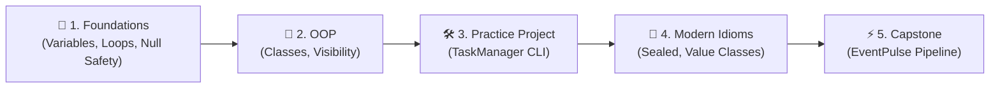
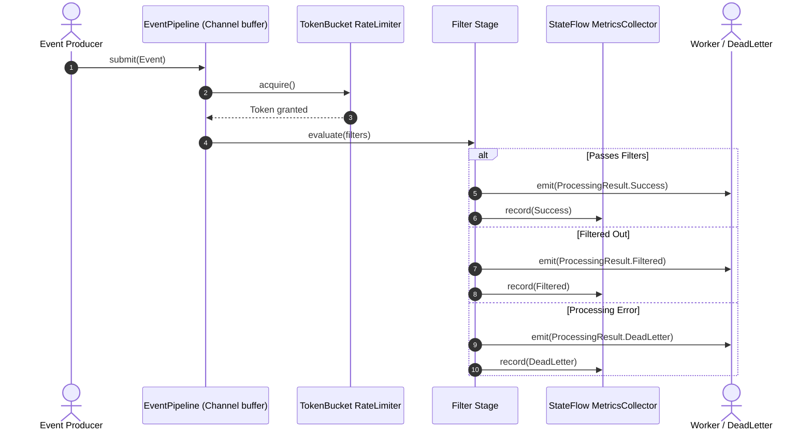

<div align="center">

# ⚡ OkKotlin
### Your Progressive Roadmap to Modern Kotlin 2.x — From First Steps to Production Systems

[](https://kotlinlang.org)
[](https://openjdk.org)
[](https://github.com/Kotlin/kotlinx.coroutines)
[](.github/workflows/ci.yml)
[](src/test/kotlin)
[](LICENSE)

<p align="center">
  Welcome to <b>OkKotlin</b>! A friendly, hands-on, step-by-step repository designed for anyone who wants to learn Kotlin.
  Start with basic syntax and gentle exercises, build an intermediate practice project, and grow all the way to advanced Coroutines, Flow, and clean architecture.
</p>

[🌱 Start Here (Beginner Guide)](#-where-to-begin) •
[📖 Full Learning Guide](docs/LEARNING_GUIDE.md) •
[Curriculum Roadmap](#-curriculum-roadmap) •
[Intermediate Practice Project](#-intermediate-bridge-project-taskmanager) •
[Capstone: EventPulse](#-advanced-capstone-project-eventpulse) •
[Tests & Verification](#-testing--hands-on-verification)

</div>

---

## 🌱 Where to Begin?

You don't need to understand complex architecture on day one. We’ve organized the repository into 5 gentle stages so you can learn at your own pace:



### Choose Your Study Path:

| Path | Background | How to Begin |
| :--- | :--- | :--- |
| 🟢 **Track A: Beginner** | New to Kotlin or programming | Start at [1.Hello, World!.kt](src/main/kotlin/programmingBasic/1.Hello,%20World!.kt) and follow the practice tasks in the [Learning Guide](docs/LEARNING_GUIDE.md). |
| 🔵 **Track B: Java Developer** | Experienced with Java or C# | Skim [Null Safety](src/main/kotlin/programmingBasic/13.Null%20Safety.kt), then jump to [OOP Modeling](src/main/kotlin/introductionToObject/) and [Modern 2.x Idioms](src/main/kotlin/modernIdioms/). |
| 🟣 **Track C: Intermediate** | Know basic Kotlin | Build the [TaskManager Practice Project](src/main/kotlin/practiceProject/TaskManager.kt) and dive into [Coroutines & Flow](src/main/kotlin/powerOfKotlin/coroutine/). |

> 📖 **Learning Guide:** Open [`docs/LEARNING_GUIDE.md`](docs/LEARNING_GUIDE.md) for foundation practice tasks, sample outputs, and selected hints.
> 💡 **Theory Primer:** Open [`Core Concepts of Programming Languages`](src/main/kotlin/programmingBasic/Core%20Concept%20of%20Programming%20Language.md) for real-world and mathematical analogies explaining variables, data structures, and algorithms.

---

## 🗺️ Curriculum Roadmap

### Stage 1: Kotlin Foundations (13 Lessons)
Located in [`src/main/kotlin/programmingBasic/`](src/main/kotlin/programmingBasic/)
1. [`1.Hello, World!.kt`](src/main/kotlin/programmingBasic/1.Hello,%20World!.kt) — Minimal entrypoint and toolchain setup
2. [`2.var & val.kt`](src/main/kotlin/programmingBasic/2.var%20&%20val.kt) — Read-only values vs mutable variables
3. [`3.Data Type.kt`](src/main/kotlin/programmingBasic/3.Data%20Type.kt) — Type inference and basic types
4. [`4.Function.kt`](src/main/kotlin/programmingBasic/4.Function.kt) — Function syntax and single-expression functions
5. [`5.If Expression.kt`](src/main/kotlin/programmingBasic/5.If%20Expression.kt) — Expression-oriented conditionals returning values
6. [`6.String Templates.kt`](src/main/kotlin/programmingBasic/6.String%20Templates.kt) — String interpolation (`$var`, `${expr}`) and raw strings
7. [`7.Number Types.kt`](src/main/kotlin/programmingBasic/7.Number%20Types.kt) — Explicit conversions between integer and floating types
8. [`8.Booleans.kt`](src/main/kotlin/programmingBasic/8.Booleans.kt) — Boolean logic and truth predicates
9. [`9.While.kt`](src/main/kotlin/programmingBasic/9.While.kt) — `while` and `do-while` loops
10. [`10.Looping & Ranges.kt`](src/main/kotlin/programmingBasic/10.Looping%20&%20Ranges.kt) — Progression ranges (`1..5`, `until`, `downTo`, `step`)
11. [`11.The in Keyword.kt`](src/main/kotlin/programmingBasic/11.The%20in%20Keyword.kt) — Interval membership checks and loop iteration
12. [`12.Expression & Statements.kt`](src/main/kotlin/programmingBasic/12.Expression%20&%20Statements.kt) — Expressions vs statements
13. [`13.Null Safety.kt`](src/main/kotlin/programmingBasic/13.Null%20Safety.kt) — Eliminating NPEs with `?`, Safe Calls (`?.`), Elvis (`?:`), and Safe Casts (`as?`)

### Stage 2: Object-Oriented Modeling
Located in [`src/main/kotlin/introductionToObject/`](src/main/kotlin/introductionToObject/)
- [`1.Objects Everywhere.kt`](src/main/kotlin/introductionToObject/1.Objects%20Everywhere.kt) — Treating primitives as objects
- [`2.Class.kt`](src/main/kotlin/introductionToObject/2.Class.kt) — Primary constructors, properties, and member functions
- [`3.Contraining Visibility.kt`](src/main/kotlin/introductionToObject/3.Contraining%20Visibility.kt) — Encapsulation with `private`, `public`, `protected`, `internal`
- [`4.Packages.kt`](src/main/kotlin/introductionToObject/4.Packages.kt) — Organizing code into namespaces and importing utilities

### Stage 3: Intermediate Practice Project (TaskManager)
Located in [`src/main/kotlin/practiceProject/TaskManager.kt`](src/main/kotlin/practiceProject/TaskManager.kt)
- A hands-on project bridging OOP and Collections before jumping into advanced concurrency.
- Features data classes, enums, collection filtering, grouping by priority, and null safety.

### Stage 4: Functional & Modern Kotlin 2.x Idioms
Located in [`src/main/kotlin/functionalProgrammingInKotlin/`](src/main/kotlin/functionalProgrammingInKotlin/) and [`src/main/kotlin/modernIdioms/`](src/main/kotlin/modernIdioms/)
- Pure functions, immutability, higher-order functions, and `Result<T>` monad error handling
- [`1.SealedHierarchiesAndPatternMatching.kt`](src/main/kotlin/modernIdioms/1.SealedHierarchiesAndPatternMatching.kt) — Algebraic Data Types & exhaustive `when` matching
- [`2.ValueClassesAndTypeSafety.kt`](src/main/kotlin/modernIdioms/2.ValueClassesAndTypeSafety.kt) — Zero-cost primitive wrapping via `@JvmInline value class`
- [`3.DelegationPatterns.kt`](src/main/kotlin/modernIdioms/3.DelegationPatterns.kt) — Property delegation (`lazy`, `observable`, `vetoable`) and class delegation
- [`4.TypeSafeBuilderDsl.kt`](src/main/kotlin/modernIdioms/4.TypeSafeBuilderDsl.kt) — Expressive declarative APIs with `@DslMarker`
- [`5.ScopeFunctionsIdioms.kt`](src/main/kotlin/modernIdioms/5.ScopeFunctionsIdioms.kt) — Clear decision matrix for `let`, `apply`, `run`, `also`, `with`

### Stage 5: Concurrency & Capstone Architecture
Located in [`src/main/kotlin/powerOfKotlin/coroutine/`](src/main/kotlin/powerOfKotlin/coroutine/) and [`src/main/kotlin/capstone/eventpulse/`](src/main/kotlin/capstone/eventpulse/)
- Coroutine primitives (`launch`, `async`, `delay` without blocking threads)
- Cold asynchronous `Flow` streams with context preservation (`flowOn`)
- Hot state holders (`StateFlow`) and event broadcasting (`SharedFlow`)
- Buffered `Channel` pipelines with backpressure handling
- Resilient `supervisorScope` failure isolation and exponential backoff retries
- **EventPulse Capstone**: A full reactive asynchronous event processing pipeline

---

## 🛠️ Intermediate Bridge Project: TaskManager

Before tackling reactive streams or coroutines, test your skills on this cohesive mini-system:

```kotlin
// Run from terminal:
// ./gradlew runPracticeProject

val manager = TaskManager()
manager.addTask(Task("t1", "Master Kotlin Basics", Priority.HIGH))
manager.addTask(Task("t2", "Explore Null Safety", Priority.HIGH))

// Safe lookup using Elvis operator fallback:
val task = manager.findTaskById("t99")?.title ?: "Task not found"
```

---

## ⚡ Advanced Capstone Project: EventPulse

Once you feel comfortable with basics, explore how modern Kotlin powers high-throughput concurrent JVM systems:



Run the Capstone Demo:
```bash
./gradlew runCapstone
```

---

## 🧪 Testing & Hands-On Verification

We believe in **Test-Driven Learning**. The repository contains **31 automated tests** covering every level of the curriculum:

```bash
# Run all 31 tests
./gradlew test
```

```
BasicConceptsTest > test number conversion without auto-widening() PASSED
BasicConceptsTest > test string template interpolation() PASSED
BasicConceptsTest > test beginner practice challenge - compute discounted price() PASSED
BasicConceptsTest > test safe call operator with null and non-null values() PASSED
BasicConceptsTest > test Elvis operator providing fallback values() PASSED
BasicConceptsTest > test expression oriented if-else() PASSED
BasicConceptsTest > test in keyword containment() PASSED
BasicConceptsTest > test while loop summation() PASSED
BasicConceptsTest > test safe cast operator as-safe preventing ClassCastException() PASSED
BasicConceptsTest > test range progression calculation() PASSED

ObjectModelingTest > test Cup initial state and capacity cap() PASSED
ObjectModelingTest > test AlienSpecies constructor properties and description() PASSED
ObjectModelingTest > test Cookie public interaction and eating() PASSED
ObjectModelingTest > test beginner practice challenge - model a BankAccount class() PASSED

TaskManagerTest > test complete task and completion rate calculation() PASSED
TaskManagerTest > test adding task and enforcing unique ID() PASSED
TaskManagerTest > test grouping tasks by priority() PASSED
TaskManagerTest > test filtering pending vs completed tasks() PASSED
TaskManagerTest > test finding task with null safety fallback() PASSED

FunctionalConceptsTest > test immutable list preservation() PASSED
FunctionalConceptsTest > test Result monad safe failure recovery() PASSED
FunctionalConceptsTest > test higher order function execution() PASSED

ModernIdiomsTest > test sealed payment status pattern matching() PASSED
ModernIdiomsTest > test value class zero-cost type safety and validation() PASSED
ModernIdiomsTest > test type-safe HTTP builder DSL() PASSED
ModernIdiomsTest > test property delegation with vetoable and trimmed string() PASSED

CoroutineAndFlowTest > test StateFlow and SharedFlow updates() PASSED
CoroutineAndFlowTest > test exponential backoff retry on transient errors() PASSED
CoroutineAndFlowTest > test cold flow transformations and emissions() PASSED

EventPipelineTest > test pipeline filtering and success dispatch() PASSED
EventPipelineTest > test dead letter handling when unhandled exception occurs() PASSED

BUILD SUCCESSFUL in 2s (31 tests passed, 0 failures)
```

---

## 💼 LinkedIn Showcase & Portfolio Kit

Ready-to-publish content to showcase your learning journey and projects on LinkedIn:
- 📄 [Launch Post Templates](docs/linkedin/LAUNCH_POST_TEMPLATE.md) — 3 high-converting post formats (Storytelling, Technical Deep-Dive, Quick Cheatsheet).
- 🎨 [Carousel Slide Blueprint](docs/linkedin/CAROUSEL_SLIDE_BLUEPRINT.md) — 7-slide layout guide on *"5 Modern Kotlin 2.x Patterns You Should Use"*.
- 🎙️ [Interview & Portfolio Guide](docs/linkedin/INTERVIEW_AND_PORTFOLIO_GUIDE.md) — 30-second elevator pitch and senior technical interview Q&A.

---

## 🚀 Quick Commands Summary

```bash
# Clone
git clone git@github.com:toptoppy/okkotlin.git
cd okkotlin

# Run main philosophy entrypoint
./gradlew run

# Run intermediate practice project
./gradlew runPracticeProject

# Run EventPulse reactive capstone demo
./gradlew runCapstone

# Run all 31 automated tests
./gradlew test
```

---

## 👨‍💻 Author

**TopToppy**  
Software Engineer & Craftsmanship Advocate  
- GitHub: [@toptoppy](https://github.com/toptoppy)  
- Organization: [ODDS Team](https://odds.team)  

---

## 📄 License

This project is licensed under the [MIT License](LICENSE).
