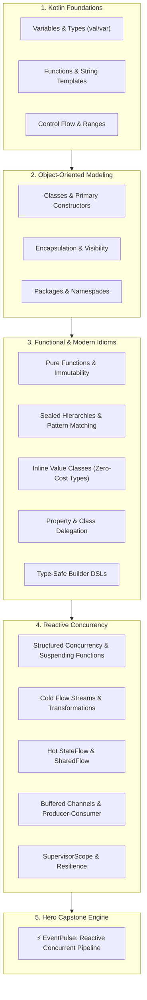
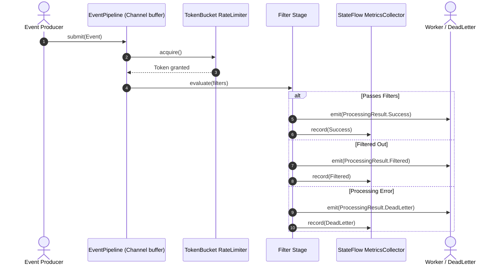

<div align="center">

# ⚡ OkKotlin
### Production-Grade Modern Kotlin 2.x Craftsmanship & Architecture Showcase

[](https://kotlinlang.org)
[](https://openjdk.org)
[](https://github.com/Kotlin/kotlinx.coroutines)
[](.github/workflows/ci.yml)
[](src/test/kotlin)
[](LICENSE)

<p align="center">
  A curated, production-grade reference architecture and progressive curriculum demonstrating <b>Modern Kotlin 2.x</b>, <b>K2 Compiler idioms</b>, <b>Structured Concurrency with Coroutines & Flow</b>, <b>Functional Domain Modeling</b>, and a reactive capstone pipeline with automated CI/CD.
</p>

[📖 Complete Learning Guide](docs/LEARNING_GUIDE.md) •
[Quick Start](#-quick-start) •
[Curriculum & Architecture](#-curriculum-roadmap) •
[Capstone: EventPulse](#-capstone-project-eventpulse) •
[Modern Kotlin 2.x Highlights](#-modern-kotlin-2x-highlights) •
[Testing & CI](#-testing--quality-engineering) •
[LinkedIn Kit](#-linkedin-portfolio-kit)

</div>

---

## 🌟 Why This Repository Stands Out

Most beginner repositories stop at basic `println()` scripts and simple classes. **OkKotlin** bridges the gap between learning Kotlin syntax and engineering production-ready JVM systems:

- 🚀 **Newest Stable Stack:** Built on **Kotlin 2.1.0 (K2 Compiler)**, **Java 21**, and **Kotlinx Coroutines 1.10.1**.
- 🛡️ **Zero-Cost Type Safety:** Using `@JvmInline value class` and sealed interfaces to eliminate primitive obsession and unhandled states at compile-time.
- 🌊 **Deep Concurrency:** Cold asynchronous `Flow`, Hot `StateFlow`/`SharedFlow`, buffered `Channel` pipelines, and resilient supervisor scopes with exponential backoff.
- ⚡ **Real-World Capstone ("EventPulse"):** An end-to-end reactive asynchronous event-processing engine with backpressure, rate limiting, and a type-safe DSL.
- 🧪 **Test-Driven Craftsmanship:** 100% test pass rate with `kotlin.test`, `kotlinx-coroutines-test` (`runTest`), and `Kotest` assertions integrated into GitHub Actions CI.

---

## 📚 How to Learn Kotlin with This Repository

If you are here to learn Kotlin, follow one of our tailored study tracks:

| Track | Background | Recommended Starting Point |
| :--- | :--- | :--- |
| 🟢 **Track A: Beginner** | New to Kotlin / Programming | Start at [Module 1: Foundations](src/main/kotlin/programmingBasic/) with [docs/LEARNING_GUIDE.md](docs/LEARNING_GUIDE.md) |
| 🔵 **Track B: Java Dev** | Experienced with Java / C# | Skip to [Module 2: OOP](src/main/kotlin/introductionToObject/) and [Module 3: Modern Idioms](src/main/kotlin/modernIdioms/) |
| 🟣 **Track C: Advanced** | Know basic Kotlin | Jump to [Module 4: Coroutines & Flow](src/main/kotlin/powerOfKotlin/coroutine/) & [Module 5: EventPulse Capstone](src/main/kotlin/capstone/eventpulse/) |

> 💡 **Detailed Step-by-Step Curriculum:** Read the full [Complete Learning Guide](docs/LEARNING_GUIDE.md) for code walkthroughs, pro-tips, and self-check exercises for every lesson.  
> 💡 **Conceptual Analogies:** Read [Core Concepts of Programming Languages](src/main/kotlin/programmingBasic/Core%20Concept%20of%20Programming%20Language.md) for real-world and mathematical analogies explaining variables, types, algorithms, and OOP.

---

## 🗺️ Curriculum Roadmap



---

## 📂 Repository Structure

| Module | Location | Key Concepts Covered |
| :--- | :--- | :--- |
| **Philosophy & Overview** | [`Main.kt`](src/main/kotlin/Main.kt) | Multi-paradigm Kotlin, language genealogy, why Kotlin over Java |
| **Programming Basics** | [`programmingBasic/`](src/main/kotlin/programmingBasic/) | 12 progressive lessons: Types, If-Expressions, While/For, Ranges, String Templates |
| **Object Orientation** | [`introductionToObject/`](src/main/kotlin/introductionToObject/) | Classes, Constructors, Visibility constraints, Packages |
| **Functional Programming** | [`functionalProgrammingInKotlin/`](src/main/kotlin/functionalProgrammingInKotlin/) | Pure functions, Immutability, Higher-order functions, Result/Optional monads |
| **Modern Kotlin 2.x Idioms** | [`modernIdioms/`](src/main/kotlin/modernIdioms/) | Sealed Interfaces, Value classes, Delegation (`by lazy`, `observable`, `vetoable`), Builder DSLs |
| **Coroutines & Flow** | [`powerOfKotlin/coroutine/`](src/main/kotlin/powerOfKotlin/coroutine/) | Cold `Flow`, `StateFlow`, `SharedFlow`, `Channel`, `supervisorScope`, Exponential retry |
| **Capstone Project** | [`capstone/eventpulse/`](src/main/kotlin/capstone/eventpulse/) | Asynchronous reactive event pipeline, token-bucket rate limiter, StateFlow metrics, Type-Safe DSL |

---

## ⚡ Capstone Project: EventPulse

**EventPulse** is a lightweight, concurrent event ingestion and processing pipeline built entirely with Kotlin idioms.



### Type-Safe Builder DSL Syntax:
```kotlin
val pipeline = eventPipeline {
    name = "HighThroughputTelemetryPipeline"
    bufferCapacity = 50
    rateLimitPerSecond = 100

    // Declarative filtering rule
    filter { event ->
        when (val payload = event.payload) {
            is EventPayload.Telemetry -> payload.metricValue > 10.0
            is EventPayload.SystemAlert -> payload.severity != AlertSeverity.INFO
            is EventPayload.UserAction -> true
        }
    }

    onDeadLetter { deadLetter ->
        archiveDeadLetter(deadLetter.rawEvent)
    }
}
```

---

## 💡 Modern Kotlin 2.x Highlights

### 1. Zero-Cost Value Classes (`@JvmInline`)
Eliminate primitive obsession without heap allocation overhead:
```kotlin
@JvmInline
value class CustomerId(val value: String) {
    init { require(value.startsWith("cust_")) }
}

@JvmInline
value class OrderId(val value: String)

// Impossible to accidentally swap parameters at compile-time:
fun process(order: OrderId, customer: CustomerId)
```

### 2. Sealed Interfaces & Exhaustive Pattern Matching
Model domain states with zero possibility of unhandled branches:
```kotlin
sealed interface PaymentStatus {
    data class Pending(val txId: String) : PaymentStatus
    data class Completed(val txId: String, val receipt: String) : PaymentStatus
    data class Failed(val txId: String, val reason: String) : PaymentStatus
}

// Compiler enforces exhaustiveness - no 'else' branch needed!
fun handle(status: PaymentStatus) = when (status) {
    is PaymentStatus.Pending -> "Pending confirmation"
    is PaymentStatus.Completed -> "Receipt: ${status.receipt}"
    is PaymentStatus.Failed -> "Alert: ${status.reason}"
}
```

---

## 🚀 Quick Start

### Prerequisites
- JDK 21+
- Git

### Build & Run
```bash
# Clone the repository
git clone git@github.com:toptoppy/okkotlin.git
cd okkotlin

# Run all unit and asynchronous coroutine tests (16 tests)
./gradlew test

# Run the EventPulse Capstone Demo
./gradlew runCapstone

# Run the Main entrypoint
./gradlew run
```

---

## 🧪 Testing & Quality Engineering

The test suite covers unit logic, coroutine flows, state changes, and pipeline throughput under concurrency:

```bash
./gradlew test --info
```

```
EventPipelineTest > test pipeline filtering and success dispatch() PASSED
EventPipelineTest > test dead letter handling when unhandled exception occurs() PASSED
CoroutineAndFlowTest > test cold flow transformations and emissions() PASSED
CoroutineAndFlowTest > test StateFlow and SharedFlow updates() PASSED
CoroutineAndFlowTest > test exponential backoff retry on transient errors() PASSED
ModernIdiomsTest > test sealed payment status pattern matching() PASSED
ModernIdiomsTest > test value class zero-cost type safety and validation() PASSED
ModernIdiomsTest > test type-safe HTTP builder DSL() PASSED
ModernIdiomsTest > test property delegation with vetoable and trimmed string() PASSED
FunctionalConceptsTest > test immutable list preservation() PASSED
FunctionalConceptsTest > test Result monad safe failure recovery() PASSED
BasicConceptsTest > test range progression calculation() PASSED
...
BUILD SUCCESSFUL (16 tests passed)
```

---

## 💼 LinkedIn Portfolio Kit

Ready-to-publish content to showcase this repository on LinkedIn:
- 📄 [Launch Post Templates](docs/linkedin/LAUNCH_POST_TEMPLATE.md) — 3 high-converting post formats (Storytelling, Technical Deep-Dive, Quick Cheatsheet).
- 🎨 [Carousel Slide Blueprint](docs/linkedin/CAROUSEL_SLIDE_BLUEPRINT.md) — 7-slide layout guide on *"5 Modern Kotlin 2.x Patterns You Should Use"*.
- 🎙️ [Interview & Portfolio Guide](docs/linkedin/INTERVIEW_AND_PORTFOLIO_GUIDE.md) — 2-minute elevator pitch and architectural talking points.

---

## 👨‍💻 Author

**TopToppy**  
Software Engineer & Craftsmanship Advocate  
- GitHub: [@toptoppy](https://github.com/toptoppy)  
- Organization: [ODDS Team](https://odds.team)  

---

## 📄 License

This project is licensed under the [MIT License](LICENSE).
