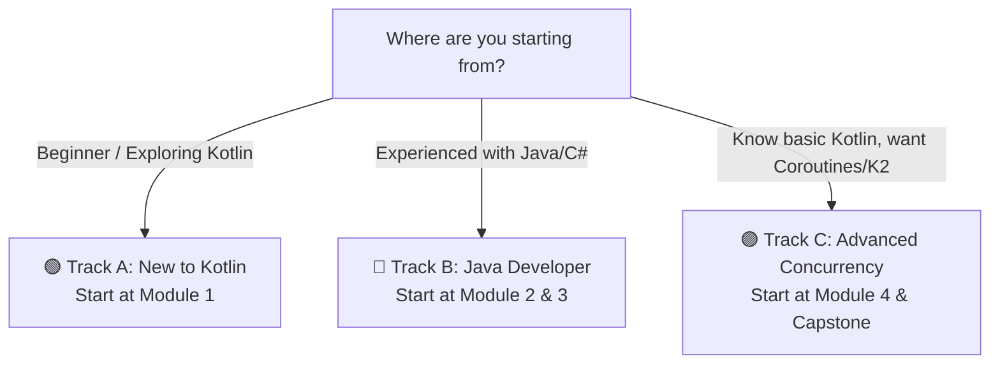

# 📚 The OkKotlin Learning & Study Guide

Welcome! Whether you are writing your first line of code, transitioning from Java, or preparing for senior Kotlin backend interviews, this guide provides a step-by-step curriculum with hands-on practice challenges for **every single lesson**.

---

## 🎯 Choose Your Learning Track



- **🟢 Track A: New to Kotlin**  
  Follow sequentially from **Module 1** through **Module 5**. Complete the practice challenge at the end of every lesson to build muscle memory!
- **🔵 Track B: Java Developer Transitioning to Kotlin**  
  Skim Module 1 for Kotlin syntax differences (`val` vs `var`, string templates, expression-oriented if/when, null safety), then dive into **Module 2 (OOP & Data Classes)**, **Module 3 (Modern Idioms & Value Classes)**, and **Module 4 (Coroutines vs Threads)**.
- **🟣 Track C: Intermediate Kotlin Developer**  
  Jump directly to **Intermediate Bridge Project (TaskManager)**, **Module 4 (Flow, Channels, Structured Concurrency)**, and **Module 5 (EventPulse Capstone Engine)**.

---

## 💻 How to Run Any Lesson & Check Tests

### Option 1: Inside IntelliJ IDEA or Android Studio (Recommended)
1. Open this repository folder in IntelliJ IDEA.
2. Navigate to any lesson file under `src/main/kotlin/`.
3. Click the green play icon (**▶️**) next to `fun main()` on line 3 or 4.
4. The output will print directly in your Run console.

### Option 2: From the Terminal via Gradle
```bash
# Run the main entrypoint
./gradlew run

# Run the intermediate TaskManager practice project
./gradlew runPracticeProject

# Run the EventPulse reactive capstone demo
./gradlew runCapstone

# Run all 31 automated tests to verify your solutions
./gradlew test
```

---

## 📖 Module 1: Kotlin Foundations (13 Lessons with Practice Challenges)

Located in: [`src/main/kotlin/programmingBasic/`](../src/main/kotlin/programmingBasic/)  
Companion Theory Guide: [`Core Concept of Programming Language.md`](../src/main/kotlin/programmingBasic/Core%20Concept%20of%20Programming%20Language.md)

---

### Lesson 1: Hello World & Toolchain Setup
- **File:** [`1.Hello, World!.kt`](../src/main/kotlin/programmingBasic/1.Hello,%20World!.kt)
- **Concept:** Every Kotlin program begins execution at a top-level `fun main()` function. Unlike Java, you do **not** need an enclosing class (`public class Main`) just to print a line. Semicolons are optional and idiomatic Kotlin omits them.
- 🎯 **Practice Task:** Modify `main()` to print your name and favorite programming goal on two separate lines.
- 📤 **Expected Output:**
  ```
  Developer: TopToppy
  Goal: Master Kotlin Coroutines & Clean Architecture
  ```

---

### Lesson 2: Variables & Immutability (`val` vs `var`)
- **File:** [`2.var & val.kt`](../src/main/kotlin/programmingBasic/2.var%20&%20val.kt)
- **Concept:**
  - `val` (Value) = Read-only reference (similar to `final` in Java). Cannot be reassigned once initialized.
  - `var` (Variable) = Mutable reference. Can be reassigned to a new value of the **same type**.
  - **Best Practice:** **Always default to `val`**. Only use `var` when you have a proven need for local state mutation.
- 🎯 **Practice Task:** Declare a `val` for `appName = "OkKotlin"` and a `var` for `downloadCount = 100`. Increase `downloadCount` by 50, then print both. Try reassigning `appName = "NewName"` to observe the compile error!
- 📤 **Expected Output:**
  ```
  App: OkKotlin, Downloads: 150
  ```
- 💡 **Hint:** Use `downloadCount += 50`.

---

### Lesson 3: Data Types & Type Inference
- **File:** [`3.Data Type.kt`](../src/main/kotlin/programmingBasic/3.Data%20Type.kt)
- **Concept:** Kotlin has a static type system with powerful type inference. Writing `val x = 10` automatically infers `Int`. Writing `val rate = 4.5` automatically infers `Double`.
- 🎯 **Practice Task:** Create three variables without explicit type annotations: an integer `items = 5`, a double `unitPrice = 12.50`, and a boolean `inStock = true`. Print the total price (`items * unitPrice`) and verify its inferred type class name using `::class.simpleName`.
- 📤 **Expected Output:**
  ```
  Total: 62.5, Type: Double
  ```

---

### Lesson 4: Functions & Parameters
- **File:** [`4.Function.kt`](../src/main/kotlin/programmingBasic/4.Function.kt)
- **Concept:** Functions are declared with `fun name(param: Type): ReturnType`. When a function is a single expression, omit braces and `return`: `fun add(a: Int, b: Int): Int = a + b`.
- 🎯 **Practice Task:** Write a single-expression function `celsiusToFahrenheit(celsius: Double): Double` that converts temperatures using the formula $(C \times 9/5) + 32$. Test it with `25.0°C`.
- 📤 **Expected Output:**
  ```
  25.0°C is equal to 77.0°F
  ```
- 💡 **Hint:** `fun celsiusToFahrenheit(celsius: Double): Double = (celsius * 9 / 5) + 32`

---

### Lesson 5: Expression-Oriented If-Else
- **File:** [`5.If Expression.kt`](../src/main/kotlin/programmingBasic/5.If%20Expression.kt)
- **Concept:** In Kotlin, `if` is an **expression**, not just a statement—it returns a value directly, replacing Java's ternary operator `? :`.
  ```kotlin
  val status = if (score >= 50) "Pass" else "Fail"
  ```
- 🎯 **Practice Task:** Write a function `trafficLightAction(color: String): String` that returns `"Stop"` for red, `"Slow down"` for yellow, `"Go"` for green, and `"Invalid color"` for anything else using an `if-else` expression.
- 📤 **Expected Output:**
  ```
  Yellow light means: Slow down
  ```

---

### Lesson 6: String Templates & Multiline Strings
- **File:** [`6.String Templates.kt`](../src/main/kotlin/programmingBasic/6.String%20Templates.kt)
- **Concept:** Interpolate variables with `$varName` and expressions with `${expression}`. Use triple quotes `"""` for multiline raw strings without escaping quotes.
- 🎯 **Practice Task:** Given `val item = "Book"` and `val price = 29.99` and `val qty = 3`, create a multiline receipt using `"""` and `.trimIndent()` calculating the subtotal inside `${price * qty}`.
- 📤 **Expected Output:**
  ```
  --- Receipt ---
  Item: Book
  Quantity: 3
  Subtotal: $89.97
  ```

---

### Lesson 7: Number Types & Explicit Conversions
- **File:** [`7.Number Types.kt`](../src/main/kotlin/programmingBasic/7.Number%20Types.kt)
- **Concept:** Kotlin does **not** automatically widen numbers. An `Int` cannot be assigned directly to a `Long`. You must explicitly call `.toLong()`, `.toDouble()`, etc.
- 🎯 **Practice Task:** Given an integer `val rawPort = 8080`, convert it into a string and append it to `"https://localhost:"`. Then convert a double `val pi = 3.14159` to an integer.
- 📤 **Expected Output:**
  ```
  Server: https://localhost:8080
  Truncated Pi: 3
  ```

---

### Lesson 8: Booleans & Logical Predicates
- **File:** [`8.Booleans.kt`](../src/main/kotlin/programmingBasic/8.Booleans.kt)
- **Concept:** Standard truth evaluation (`&&`, `||`, `!`) with short-circuiting logic.
- 🎯 **Practice Task:** Write a function `canAccessVipLounge(isTicketHolder: Boolean, isStaff: Boolean, isBlacklisted: Boolean): Boolean`. Access is granted if the person is NOT blacklisted AND (is a ticket holder OR is staff).
- 📤 **Expected Output:**
  ```
  Customer (Ticket=true, Staff=false, Blacklisted=false) -> Access: true
  Customer (Ticket=true, Staff=false, Blacklisted=true) -> Access: false
  ```

---

### Lesson 9: While & Do-While Loops
- **File:** [`9.While.kt`](../src/main/kotlin/programmingBasic/9.While.kt)
- **Concept:** Standard `while` evaluates condition before execution; `do-while` guarantees at least one execution before condition checking.
- 🎯 **Practice Task:** Write a `while` loop that simulates rolling a 6-sided die (or incrementing a counter) until it hits the number 6, printing each attempt number.
- 📤 **Expected Output:**
  ```
  Attempt 1: rolled 2
  Attempt 2: rolled 4
  Attempt 3: rolled 6 (Goal reached!)
  ```

---

### Lesson 10: For Loops & Number Ranges
- **File:** [`10.Looping & Ranges.kt`](../src/main/kotlin/programmingBasic/10.Looping%20&%20Ranges.kt)
- **Concept:** Progression ranges:
  - `1..5` (inclusive: 1, 2, 3, 4, 5)
  - `0 until 5` (exclusive: 0, 1, 2, 3, 4)
  - `10 downTo 0 step 2` (descending: 10, 8, 6, 4, 2, 0)
- 🎯 **Practice Task:** Using a single `for` loop with `downTo` and `step`, count down from 10 to 2 by 2s and print each number.
- 📤 **Expected Output:**
  ```
  10 8 6 4 2
  ```

---

### Lesson 11: The `in` Keyword & Intervals
- **File:** [`11.The in Keyword.kt`](../src/main/kotlin/programmingBasic/11.The%20in%20Keyword.kt)
- **Concept:** Used for iteration (`for (ch in "Kotlin")`) and containment checking (`if (score in 80..100)`).
- 🎯 **Practice Task:** Write a function `isLetterOrDigit(char: Char): Boolean` that checks if a character is in `'a'..'z'`, `'A'..'Z'`, or `'0'..'9'` using the `in` keyword.
- 📤 **Expected Output:**
  ```
  'k' is alphanumeric: true
  '#' is alphanumeric: false
  ```

---

### Lesson 12: Expressions vs Statements
- **File:** [`12.Expression & Statements.kt`](../src/main/kotlin/programmingBasic/12.Expression%20&%20Statements.kt)
- **Concept:** An expression evaluates to a value; a statement executes for side-effect. Kotlin `when`, `if`, and `try-catch` are all expressions.
- 🎯 **Practice Task:** Write a `when` expression that maps HTTP status codes (`200 -> "OK"`, `404 -> "Not Found"`, `500 -> "Internal Error"`, `else -> "Unknown"`) and assigns the result directly to a `val statusText`.
- 📤 **Expected Output:**
  ```
  HTTP 404: Not Found
  ```

---

### Lesson 13: Null Safety, Safe Calls (`?.`) & Elvis (`?:`)
- **File:** [`13.Null Safety.kt`](../src/main/kotlin/programmingBasic/13.Null%20Safety.kt)
- **Concept:**
  - `String` cannot be null. `String?` can be null.
  - Safe call: `name?.length` returns `Int?` (null if name is null).
  - Elvis operator: `name ?: "Anonymous"` returns default value when left-hand side is null.
  - Safe let: `name?.let { ... }` runs block only if not null.
- 🎯 **Practice Task:** Write a function `formatUserGreeting(nickname: String?): String`. If `nickname` is provided, return `"Welcome back, $nickname!"`. If it is null, return `"Welcome, Guest!"` using the Elvis operator (`?:`).
- 📤 **Expected Output:**
  ```
  Greeting 1: Welcome back, Alex!
  Greeting 2: Welcome, Guest!
  ```
- 💡 **Hint:** `val name = nickname ?: "Guest"; return "Welcome, $name!"`

---

## 🏛️ Module 2: Object-Oriented Modeling (With Practice Challenges)

Located in: [`src/main/kotlin/introductionToObject/`](../src/main/kotlin/introductionToObject/)

### 1. Objects Everywhere
- **File:** [`1.Objects Everywhere.kt`](../src/main/kotlin/introductionToObject/1.Objects%20Everywhere.kt)
- **Concept:** Primitives are unified with objects at language level.
- 🎯 **Practice Task:** Explore calls on numbers directly: `42.toDouble()`, `-15.coerceAtLeast(0)`.

### 2. Classes & Primary Constructors
- **File:** [`2.Class.kt`](../src/main/kotlin/introductionToObject/2.Class.kt)
- **Concept:** Primary constructor in class header.
- 🎯 **Practice Task:** Create a `Rectangle(val width: Double, val height: Double)` class with an `area()` single-expression method.
- 📤 **Expected Output:** `Rectangle(4.0, 5.0).area() == 20.0`.

### 3. Encapsulation & Visibility
- **File:** [`3.Contraining Visibility.kt`](../src/main/kotlin/introductionToObject/3.Contraining%20Visibility.kt)
- **Modifiers:** `public` (default), `private`, `protected`, `internal`.
- 🎯 **Practice Task:** Model a `BankAccount` where `balance` has a private setter (`private set`) so external code can only deposit or withdraw via validated methods.

---

## 🛠️ Module 3: Intermediate Bridge Project (TaskManager)

Located in: [`src/main/kotlin/practiceProject/TaskManager.kt`](../src/main/kotlin/practiceProject/TaskManager.kt)  
Test Suite: [`src/test/kotlin/practiceProject/TaskManagerTest.kt`](../src/test/kotlin/practiceProject/TaskManagerTest.kt)

Before advancing into Coroutines and Channels, this project bridges your object-oriented knowledge with practical collections and domain modeling:
- **Data Classes:** `data class Task(id, title, priority, isCompleted, dueDate)`
- **Enums:** `Priority.LOW`, `Priority.MEDIUM`, `Priority.HIGH`
- **Collection Pipelines:** `groupBy`, `filter`, `sortedWith`, `count`
- **Null Safety in Action:** Safe lookups with `find { ... }` and Elvis fallback.

Run it anytime with:
```bash
./gradlew runPracticeProject
```

---

## 🌿 Module 4: Functional & Modern Kotlin 2.x Idioms

Located in: [`src/main/kotlin/functionalProgrammingInKotlin/`](../src/main/kotlin/functionalProgrammingInKotlin/) and [`src/main/kotlin/modernIdioms/`](../src/main/kotlin/modernIdioms/)

1. **Pure Functions & Immutability:** [`1.Functional Concept.kt`](../src/main/kotlin/functionalProgrammingInKotlin/1.Functional%20Concept.kt)
2. **Sealed Hierarchies & Pattern Matching:** [`1.SealedHierarchiesAndPatternMatching.kt`](../src/main/kotlin/modernIdioms/1.SealedHierarchiesAndPatternMatching.kt)
3. **Zero-Cost Value Classes:** [`2.ValueClassesAndTypeSafety.kt`](../src/main/kotlin/modernIdioms/2.ValueClassesAndTypeSafety.kt)
4. **Property & Class Delegation:** [`3.DelegationPatterns.kt`](../src/main/kotlin/modernIdioms/3.DelegationPatterns.kt)
5. **Type-Safe Builder DSLs:** [`4.TypeSafeBuilderDsl.kt`](../src/main/kotlin/modernIdioms/4.TypeSafeBuilderDsl.kt)
6. **Scope Functions Cheat Sheet:** [`5.ScopeFunctionsIdioms.kt`](../src/main/kotlin/modernIdioms/5.ScopeFunctionsIdioms.kt)

---

## ⚡ Module 5: Asynchronous Coroutines & Capstone Engine

Located in: [`src/main/kotlin/powerOfKotlin/coroutine/`](../src/main/kotlin/powerOfKotlin/coroutine/) and [`src/main/kotlin/capstone/eventpulse/`](../src/main/kotlin/capstone/eventpulse/)

1. **Coroutine Primitives:** [`0.Coroutine Concept.kt`](../src/main/kotlin/powerOfKotlin/coroutine/0.Coroutine%20Concept.kt)
2. **Cold Reactive Flow:** [`1.FlowAndReactiveStreams.kt`](../src/main/kotlin/powerOfKotlin/coroutine/1.FlowAndReactiveStreams.kt)
3. **Hot StateFlow & SharedFlow:** [`2.StateFlowAndSharedFlow.kt`](../src/main/kotlin/powerOfKotlin/coroutine/2.StateFlowAndSharedFlow.kt)
4. **Buffered Channels:** [`3.ChannelsAndActorPatterns.kt`](../src/main/kotlin/powerOfKotlin/coroutine/3.ChannelsAndActorPatterns.kt)
5. **SupervisorScope & Resilience:** [`4.StructuredConcurrencyAndResilience.kt`](../src/main/kotlin/powerOfKotlin/coroutine/4.StructuredConcurrencyAndResilience.kt)
6. **Hero Capstone: EventPulse:** [`capstone/eventpulse/`](../src/main/kotlin/capstone/eventpulse/)

Run the Capstone:
```bash
./gradlew runCapstone
```
