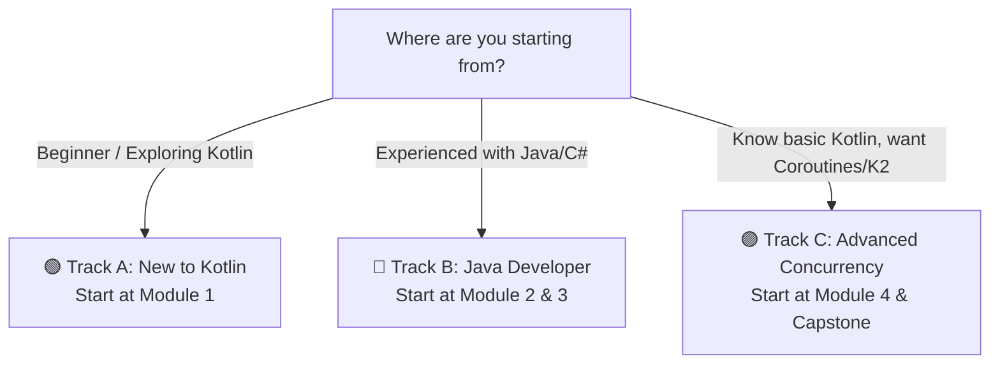

# 📚 The OkKotlin Learning & Study Guide

Welcome! Whether you are writing your first line of code, transitioning from Java, or preparing for senior Kotlin backend interviews, this guide provides a step-by-step curriculum to master modern Kotlin from first principles to production architecture.

---

## 🎯 Choose Your Learning Track



- **🟢 Track A: New to Kotlin**  
  Follow the curriculum sequentially from **Module 1** through **Module 5**. Every lesson includes runnable code and self-assessment challenges.
- **🔵 Track B: Java Developer Transitioning to Kotlin**  
  Skim Module 1 for Kotlin syntax quirks (`val` vs `var`, string templates, expressions vs statements), then dive into **Module 2 (OOP & Data Classes)**, **Module 3 (Modern Idioms & Value Classes)**, and **Module 4 (Coroutines vs Virtual Threads)**.
- **🟣 Track C: Intermediate Kotlin Developer**  
  Jump directly to **Module 4 (Flow, Channels, Structured Concurrency)** and **Module 5 (EventPulse Capstone Engine)**.

---

## 💻 How to Run Any Lesson

### Option 1: Inside IntelliJ IDEA or Android Studio (Recommended)
1. Open this repository folder in IntelliJ IDEA.
2. Navigate to any file under `src/main/kotlin/`.
3. Click the green play icon (**▶️**) next to `fun main()` on line 3 or 4.
4. The output will print directly in your Run console.

### Option 2: From the Terminal via Gradle
```bash
# Run the main entrypoint
./gradlew run

# Run the EventPulse reactive capstone demo
./gradlew runCapstone

# Run all 16 automated tests to verify your understanding
./gradlew test
```

---

## 📖 Module 1: Kotlin Foundations (12 Lessons)

Located in: [`src/main/kotlin/programmingBasic/`](../src/main/kotlin/programmingBasic/)  
Companion Theory Guide: [`Core Concept of Programming Language.md`](../src/main/kotlin/programmingBasic/Core%20Concept%20of%20Programming%20Language.md)

### Lesson 1: Hello World & Toolchain Setup
- **File:** [`1.Hello, World!.kt`](../src/main/kotlin/programmingBasic/1.Hello,%20World!.kt)
- **Concept:** Every Kotlin program begins execution at a top-level `fun main()` function. Unlike Java, you do **not** need an enclosing class (`public class Main`) just to print a line.
- **Key Takeaway:** Semicolons are optional and idiomatic Kotlin omits them.
- 🎯 **Challenge:** Modify `1.Hello, World!.kt` to print your name and current date using standard string output.

### Lesson 2: Variables & Immutability (`val` vs `var`)
- **File:** [`2.var & val.kt`](../src/main/kotlin/programmingBasic/2.var%20&%20val.kt)
- **Concept:** 
  - `val` (Value) = Read-only reference (similar to `final` in Java). Cannot be reassigned.
  - `var` (Variable) = Mutable reference. Can be reassigned to a new value of the **same type**.
- **Best Practice Rule:** **Always default to `val`**. Only use `var` when you have a proven need for local state mutation.

### Lesson 3: Data Types & Type Inference
- **File:** [`3.Data Type.kt`](../src/main/kotlin/programmingBasic/3.Data%20Type.kt)
- **Concept:** Kotlin has a static type system with powerful type inference. Writing `val x = 10` automatically infers `Int`.
- **Key Types:** `Int`, `Long`, `Double`, `Float`, `Boolean`, `String`, `Char`.
- **Smart Casting:** Once a variable is checked with `is String`, Kotlin automatically casts it—no manual `(String) obj` cast required!

### Lesson 4: Functions & Default Arguments
- **File:** [`4.Function.kt`](../src/main/kotlin/programmingBasic/4.Function.kt)
- **Concept:** Functions are declared with `fun name(param: Type): ReturnType`.
- **Single-Expression Syntax:** When a function body is just a single expression, omit braces and `return`:
  ```kotlin
  fun add(a: Int, b: Int): Int = a + b
  ```

### Lesson 5: Expression-Oriented If-Else
- **File:** [`5.If Expression.kt`](../src/main/kotlin/programmingBasic/5.If%20Expression.kt)
- **Concept:** In Kotlin, `if` is an **expression**, not just a statement—it returns a value!
  ```kotlin
  val max = if (a > b) a else b // Replaces the Java ternary operator (a > b ? a : b)
  ```

### Lesson 6: String Templates & Multiline Strings
- **File:** [`6.String Templates.kt`](../src/main/kotlin/programmingBasic/6.String%20Templates.kt)
- **Concept:** 
  - Interpolate variables with `$variableName`.
  - Interpolate expressions with `${person.name.uppercase()}`.
  - Multiline raw strings with triple quotes `"""` and `.trimIndent()`.

### Lesson 7: Number Types & Conversions
- **File:** [`7.Number Types.kt`](../src/main/kotlin/programmingBasic/7.Number%20Types.kt)
- **Concept:** Numbers do not automatically widen. An `Int` cannot be assigned directly to a `Long`; you must call explicit conversion functions like `.toLong()` or `.toDouble()`.

### Lesson 8: Booleans & Logical Operators
- **File:** [`8.Booleans.kt`](../src/main/kotlin/programmingBasic/8.Booleans.kt)
- **Concept:** Standard truth evaluation (`&&`, `||`, `!`) with short-circuiting logic.

### Lessons 9 & 10: Loops, Iteration & Number Ranges
- **Files:** [`9.While.kt`](../src/main/kotlin/programmingBasic/9.While.kt) and [`10.Looping & Ranges.kt`](../src/main/kotlin/programmingBasic/10.Looping%20&%20Ranges.kt)
- **Concept:** Kotlin provides expressive progression ranges:
  - `1..5` (inclusive: 1, 2, 3, 4, 5)
  - `0 until 5` (exclusive of upper bound: 0, 1, 2, 3, 4)
  - `10 downTo 1 step 2` (descending: 10, 8, 6, 4, 2)

### Lesson 11: The `in` Keyword
- **File:** [`11.The in Keyword.kt`](../src/main/kotlin/programmingBasic/11.The%20in%20Keyword.kt)
- **Concept:** Used for both iteration (`for (item in list)`) and interval membership testing (`if (char in 'a'..'z')`).

### Lesson 12: Expressions vs Statements
- **File:** [`12.Expression & Statements.kt`](../src/main/kotlin/programmingBasic/12.Expression%20&%20Statements.kt)
- **Concept:** An **expression** yields a value; a **statement** produces only a side effect. Most Kotlin constructs (`if`, `when`, `try-catch`) are expressions.

---

## 🏛️ Module 2: Object-Oriented Modeling (4 Lessons)

Located in: [`src/main/kotlin/introductionToObject/`](../src/main/kotlin/introductionToObject/)

### 1. Objects Everywhere
- **File:** [`1.Objects Everywhere.kt`](../src/main/kotlin/introductionToObject/1.Objects%20Everywhere.kt)
- **Concept:** In Kotlin, there are no primitive types like `int` vs `Integer` at the language level. Everything can be treated as an object with member methods.

### 2. Classes & Primary Constructors
- **File:** [`2.Class.kt`](../src/main/kotlin/introductionToObject/2.Class.kt)
- **Concept:** Primary constructors are declared directly in the class header:
  ```kotlin
  class AlienSpecies(val name: String, var population: Long) {
      fun describe() = "$name has population of $population"
  }
  ```

### 3. Visibility Modifiers & Encapsulation
- **File:** [`3.Contraining Visibility.kt`](../src/main/kotlin/introductionToObject/3.Contraining%20Visibility.kt)
- **Visibility Levels:**
  - `public` (default in Kotlin!)
  - `private` (visible only in the declaring class or file)
  - `protected` (visible in subclasses)
  - `internal` (visible anywhere inside the same Gradle module)

### 4. Packages & Namespaces
- **File:** [`4.Packages.kt`](../src/main/kotlin/introductionToObject/4.Packages.kt)
- **Concept:** Package structure does not have to strictly match directory path (though following convention is recommended). Imports can be renamed using `import foo.Bar as MyBar`.

---

## 🌿 Module 3: Functional & Modern Kotlin 2.x Idioms

Located in: [`src/main/kotlin/functionalProgrammingInKotlin/`](../src/main/kotlin/functionalProgrammingInKotlin/) and [`src/main/kotlin/modernIdioms/`](../src/main/kotlin/modernIdioms/)

### 1. Pure Functions & Immutability
- **File:** [`1.Functional Concept.kt`](../src/main/kotlin/functionalProgrammingInKotlin/1.Functional%20Concept.kt)
- **Contrast:** Compare imperative mutable lists (`mutableListOf`) vs read-only persistent lists (`listOf`).
- **Higher-Order Functions:** Passing lambdas as parameters and chaining transformations (`map`, `flatMap`, `filter`).
- **Railway Error Handling:** Using `Result<T>` and `runCatching` instead of unstructured try-catch blocks.

### 2. Sealed Interfaces & Pattern Matching
- **File:** [`1.SealedHierarchiesAndPatternMatching.kt`](../src/main/kotlin/modernIdioms/1.SealedHierarchiesAndPatternMatching.kt)
- **Concept:** Modeling domain states as Algebraic Data Types. When you match on a `sealed interface`, the compiler checks for exhaustiveness—no `else` branch is needed.

### 3. Zero-Cost Value Classes (`@JvmInline`)
- **File:** [`2.ValueClassesAndTypeSafety.kt`](../src/main/kotlin/modernIdioms/2.ValueClassesAndTypeSafety.kt)
- **Concept:** Wrap primitives (`OrderId`, `CustomerId`, `UsdAmount`) to prevent accidental argument swapping. At JVM bytecode level, the value is inlined with **zero heap allocation**.

### 4. Property & Class Delegation
- **File:** [`3.DelegationPatterns.kt`](../src/main/kotlin/modernIdioms/3.DelegationPatterns.kt)
- **Built-in Delegates:**
  - `by lazy`: Thread-safe computation deferred until first access.
  - `by Delegates.observable`: Fires a listener callback on every state change.
  - `by Delegates.vetoable`: Intercepts state modifications and can reject them if invalid.
- **Class Delegation (`by`):** Seamless composition without boilerplate decorator pass-through methods.

### 5. Type-Safe Builder DSLs
- **File:** [`4.TypeSafeBuilderDsl.kt`](../src/main/kotlin/modernIdioms/4.TypeSafeBuilderDsl.kt)
- **Concept:** Using `@DslMarker` and lambdas with receiver (`Builder.() -> Unit`) to construct declarative APIs like Gradle Kotlin DSL or Jetpack Compose.

### 6. Scope Functions Cheat Sheet
- **File:** [`5.ScopeFunctionsIdioms.kt`](../src/main/kotlin/modernIdioms/5.ScopeFunctionsIdioms.kt)
- **Quick Selection Matrix:**
  - Need to configure an object and return it? 👉 **`apply`**
  - Need to run a null-check on a nullable variable? 👉 **`?.let`**
  - Need to log or debug a value in a chain without altering it? 👉 **`also`**
  - Need to configure an object and compute a result? 👉 **`run`**
  - Have a non-nullable object and want to group multiple calls? 👉 **`with`**

---

## ⚡ Module 4: Asynchronous Concurrency with Coroutines & Flow

Located in: [`src/main/kotlin/powerOfKotlin/coroutine/`](../src/main/kotlin/powerOfKotlin/coroutine/)

### 1. Coroutine Foundations
- **File:** [`0.Coroutine Concept.kt`](../src/main/kotlin/powerOfKotlin/coroutine/0.Coroutine%20Concept.kt)
- **Suspending Functions:** Unlike `Thread.sleep()`, calling `delay()` pauses the coroutine **without blocking the underlying thread**.
- **Builders:** `runBlocking` (bridges blocking code to coroutines), `launch` (fire-and-forget), and `async` (returns a `Deferred<T>` value awaited via `.await()`).

### 2. Cold Reactive Streams (`Flow`)
- **File:** [`1.FlowAndReactiveStreams.kt`](../src/main/kotlin/powerOfKotlin/coroutine/1.FlowAndReactiveStreams.kt)
- **Concept:** A `Flow` is a cold stream: it produces values only when an active collector calls `.collect()`.
- **Context Preservation:** Use `.flowOn(Dispatchers.Default)` to ensure compute-heavy transformations run on background worker pools without affecting the caller.

### 3. Hot Streams: `StateFlow` vs `SharedFlow`
- **File:** [`2.StateFlowAndSharedFlow.kt`](../src/main/kotlin/powerOfKotlin/coroutine/2.StateFlowAndSharedFlow.kt)
- **`StateFlow`**: Holds the current state (like observable live data); updates are conflated.
- **`SharedFlow`**: Broadcasts one-off events (like toasts, errors, or navigation triggers) to multiple concurrent subscribers.

### 4. Channels & Producer-Consumer
- **File:** [`3.ChannelsAndActorPatterns.kt`](../src/main/kotlin/powerOfKotlin/coroutine/3.ChannelsAndActorPatterns.kt)
- **Concept:** `Channel<T>` allows coroutines to pass streams of items to each other with built-in backpressure.

### 5. Structured Concurrency & Resilience
- **File:** [`4.StructuredConcurrencyAndResilience.kt`](../src/main/kotlin/powerOfKotlin/coroutine/4.StructuredConcurrencyAndResilience.kt)
- **`supervisorScope`**: Ensures that if one background task throws an unhandled exception, it does **not** cancel its sibling tasks.
- **Cooperative Cancellation**: Check `ensureActive()` inside CPU loops to allow clean cancellation.
- **Exponential Backoff**: Resilient retry logic for transient network or database failures.

---

## 🚀 Module 5: Capstone Project ("EventPulse")

Located in: [`src/main/kotlin/capstone/eventpulse/`](../src/main/kotlin/capstone/eventpulse/)

To see all these concepts harmonized in a single production system, explore **EventPulse**:
- **Domain Modeling**: [EventModels.kt](../src/main/kotlin/capstone/eventpulse/model/EventModels.kt) (Value classes, Sealed interface payloads, and Results).
- **Concurrency & Rate Limiting**: [RateLimiter.kt](../src/main/kotlin/capstone/eventpulse/engine/RateLimiter.kt) (Token bucket with Coroutine Mutex).
- **Reactive Stream Engine**: [EventPipeline.kt](../src/main/kotlin/capstone/eventpulse/engine/EventPipeline.kt) (Channel buffering, filter evaluation, dead-letter routing).
- **Type-Safe DSL**: [PipelineDsl.kt](../src/main/kotlin/capstone/eventpulse/dsl/PipelineDsl.kt).
- **Live Demo Runner**: [EventPulseDemo.kt](../src/main/kotlin/capstone/eventpulse/EventPulseDemo.kt).

Run it anytime with:
```bash
./gradlew runCapstone
```

---

## 🧪 Testing Your Understanding

We have 16 unit and coroutine tests in [`src/test/kotlin/`](../src/test/kotlin/).

Run the test suite:
```bash
./gradlew test
```

Try this learning exercise:
1. Open [`src/test/kotlin/programmingBasic/BasicConceptsTest.kt`](../src/test/kotlin/programmingBasic/BasicConceptsTest.kt).
2. Write a new test verifying a new Kotlin concept you just learned.
3. Run `./gradlew test` to see your test execute and turn green!
